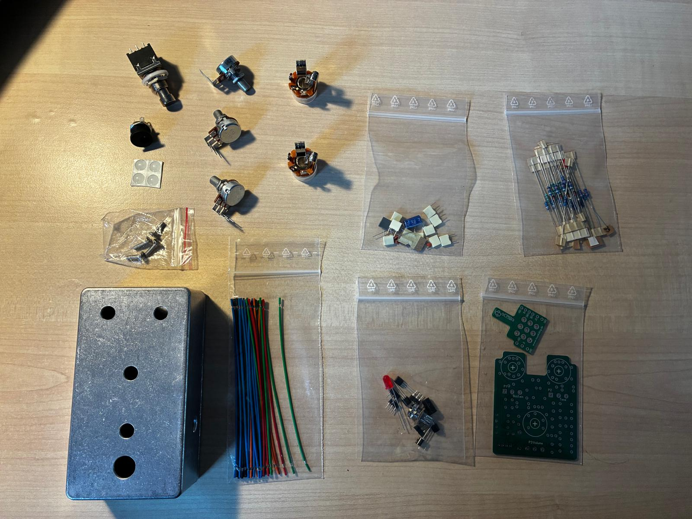
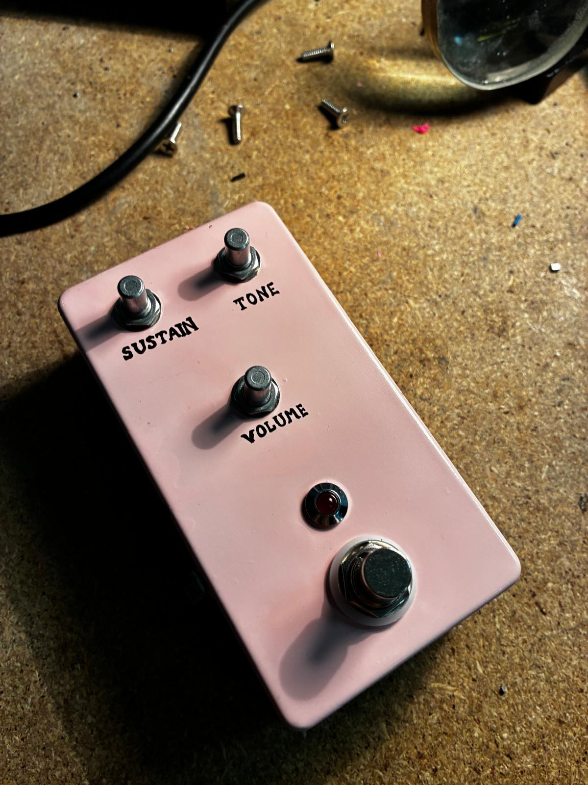
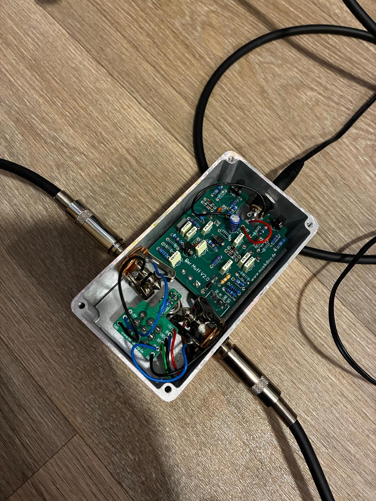

# Building and modeling a distortion pedal for bass

## The "Big Muff Green Russian" pedal

### Motivation

The Big Muff pedal brought significant change to the music industry in the early 70s. Most of my favorite artists used at least one of its variation : 
- _David Gilmour_ and the **Ram's Head**
- _John Frusciante_ and the **Red and Black**
- Nine Inch Nails' guitarist _Robin Finck_ and the **Green Russian**
- Muse's bassist _Chris Wolstenholme_ and the **Black Russian**
- _My Bloody Valentine_ and the **Electro-Harmonix Big Muff Pi**. 

Like most bassists, my love for this instrument was born out of two things : Flea's slap technique and Chris' tone (my appreciation for NIN and MBV came later).

This is why I chose to use Das Musikding's kit for the [ Big Muff Green Russian](https://www.musikding.de/Der-Muff-Green-Russian-Distortion-Bausatz): this model is naturally well-suited for bass, as the differences between the circuits of the Green and Black Russian are negligible.  
It is also an elegant, straightforward circuit to build: the original 1990s Sovtek Civil War and Green Russian units were famously manufactured using Russian military surplus components.

### Project Overview

The goal of this project is to assemble the physical pedal to gain hands-on experience with analog hardware fabrication, and to numerically model its four non-linear gain and clipping stages using Python and LTspice.

## My Assembled pedal  

With this kit from Musikding.de :

I painted, soldered and assembled my pedal : 

## My Model

TODO: add figures (Bode...) and audio amples of the simulated audios
